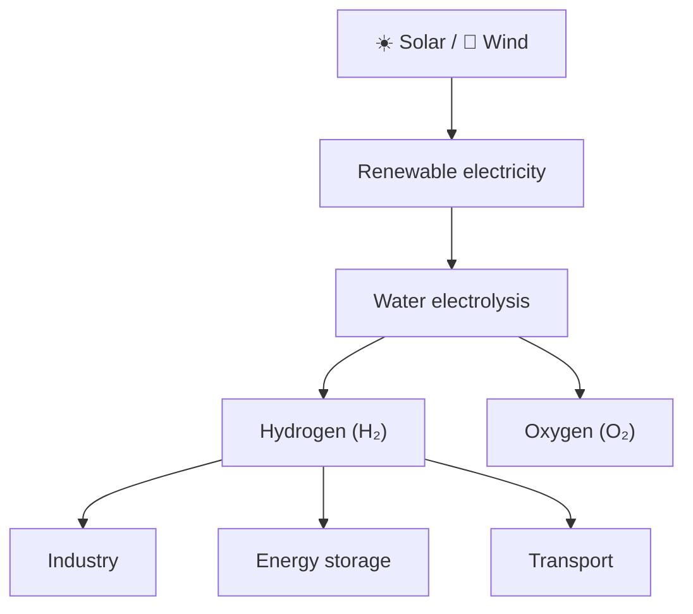

  

  

  
  

  <a href="#about">About</a> •
  <a href="#education">Education</a> •
  <a href="#research-interests">Research</a> •
  <a href="#skills">Skills</a> •
  <a href="#contact">Contact</a>

---

## 👋 About me

Hi, I'm **Daouda Savadogo**, a chemistry graduate currently pursuing a Master's degree in **Green Hydrogen Technology**.

I am interested in how science, technology and good policy can work together to deliver clean, affordable and reliable energy. My focus is on green hydrogen production from renewable electricity and on its role in the energy transition.

> 🎯 **Goal:** contribute to sustainable energy solutions, especially in Africa, where abundant solar and wind resources can power a hydrogen economy.

---

## 🎓 Education

| Level | Field | Institution | Period |
|:---|:---|:---|:---|
| Master's | Green Hydrogen Technology | *Your university* | *20XX – present* |
| Bachelor's | Chemistry | *Your university* | *20XX – 20XX* |

---

## 🔬 Research interests

**🌱 Green hydrogen**
Water electrolysis (alkaline, PEM, SOEC), hydrogen storage and transport, industrial and energy applications.

**☀️ Renewable energy**
Solar PV, wind, integration of renewables with electrolysis, energy storage.

**🧪 Chemistry & materials**
Electrochemistry, catalysts and materials for energy, corrosion and durability, photovoltaic materials.

**🌍 Sustainable energy development**
Energy transition and energy security in Africa, climate change mitigation, hydrogen policy and economic opportunities.

### Green hydrogen pathway

---

## 🧰 Skills

**Scientific:** electrochemistry · hydrogen production technologies · research and data analysis · academic and technical writing · scientific presentation

**Tools:**

  
  
  
  

**Languages:** 🇫🇷 French · 🇬🇧 English

---

## 📌 Currently exploring

- Efficiency and cost of water electrolysis technologies
- Integrating solar power into hydrogen production
- Hydrogen storage and infrastructure
- Green hydrogen opportunities across Africa

---

## 📫 Contact

I'm open to academic discussions, scientific collaborations and professional exchanges on green hydrogen, electrochemistry, renewable energy and the energy transition in Africa.

  
  

  <em>🌱 Contributing to a cleaner and more sustainable energy future.</em>

  

